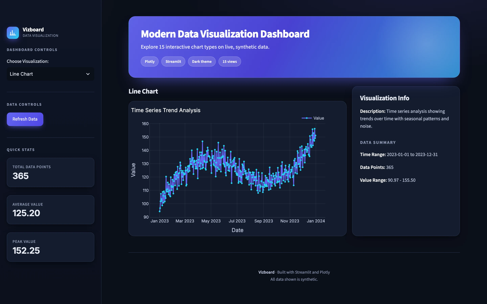
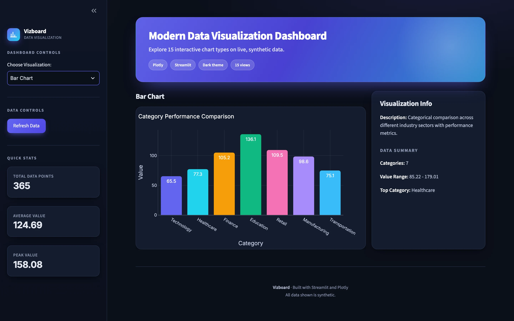
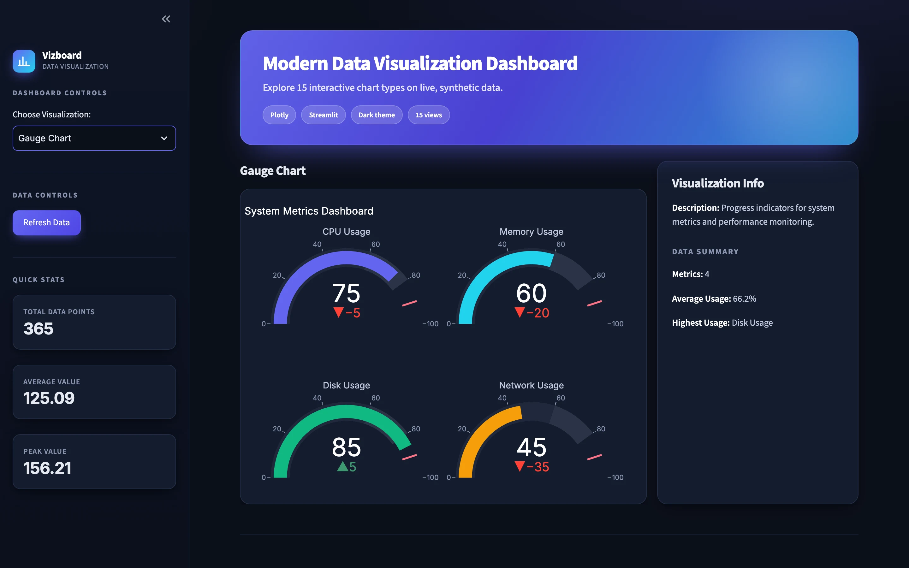
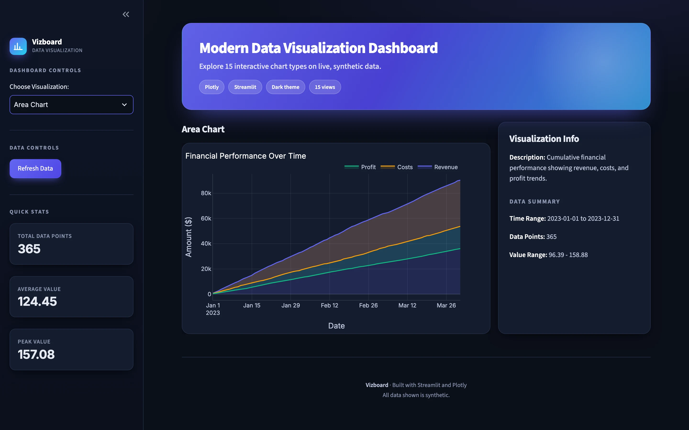
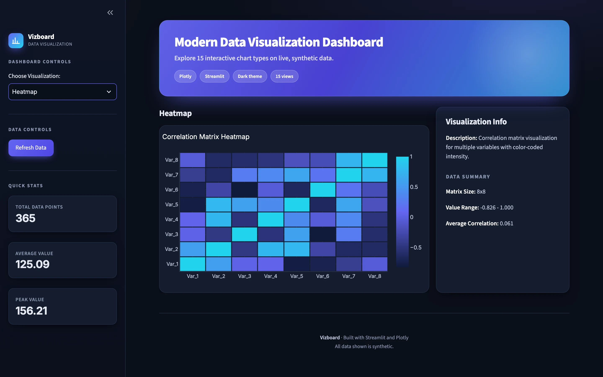
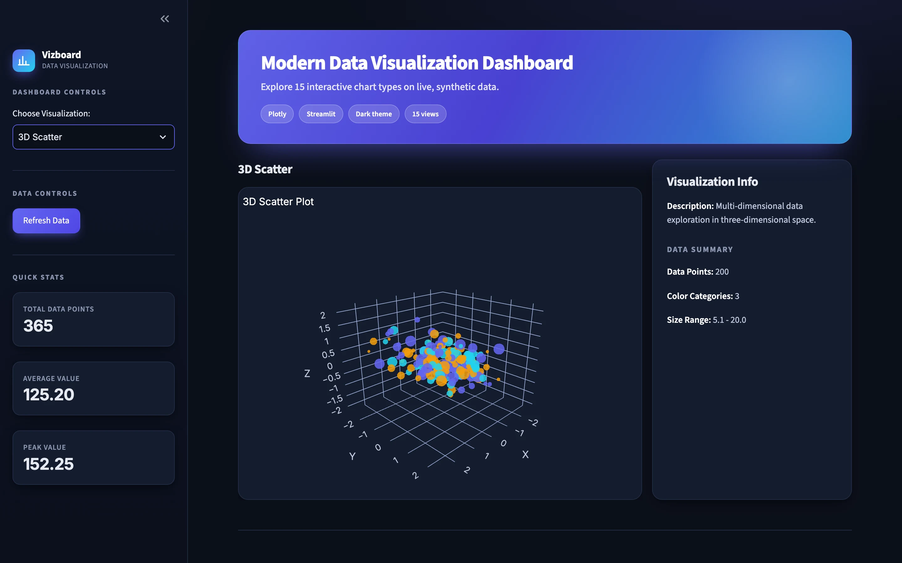
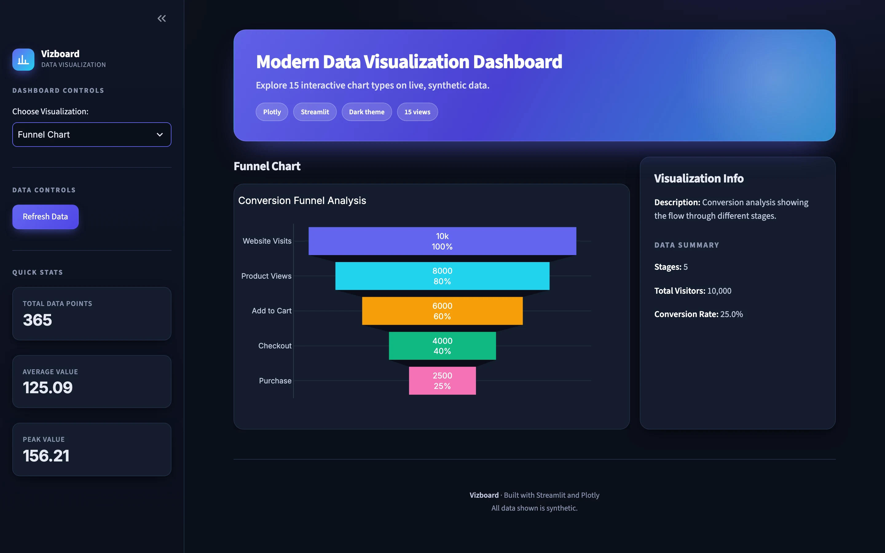
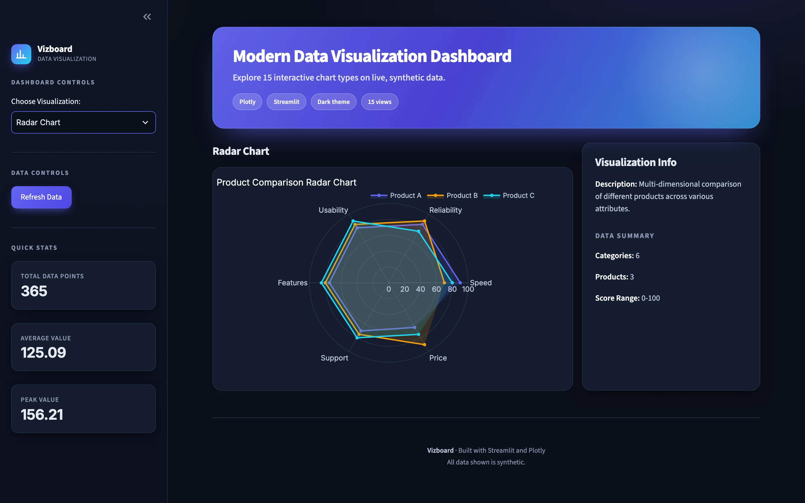
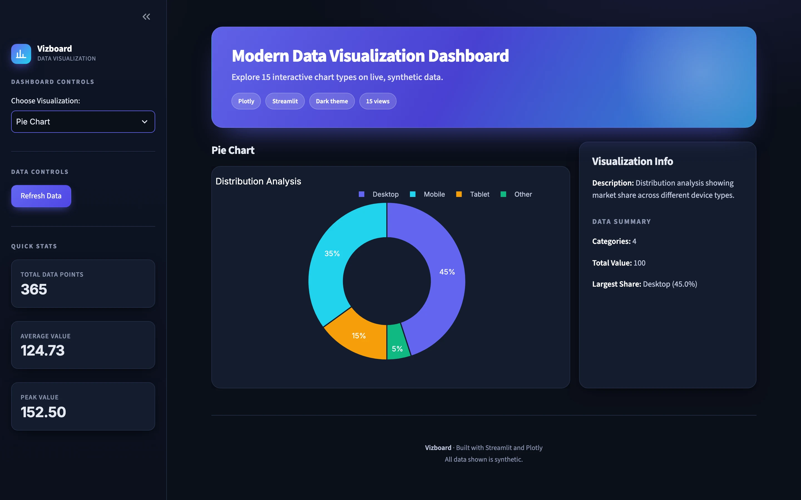
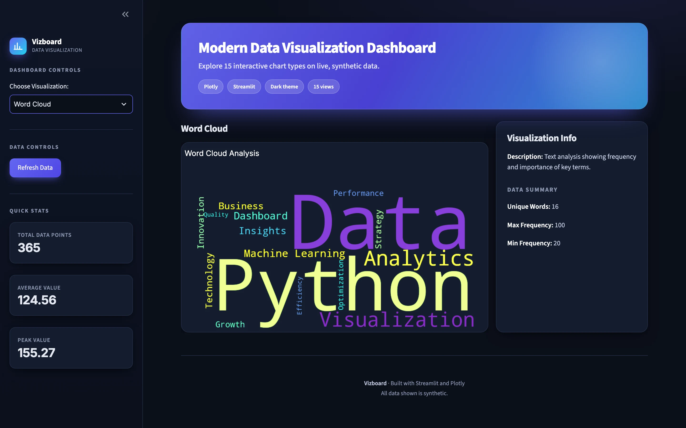

# Vizboard: Modern Data Visualization Dashboard

**An interactive dashboard that showcases 15 chart types on synthetic data, with a dark theme and a single sidebar selector.**

Python · Streamlit · Plotly · Folium · WordCloud · pandas

<table>
  <tr>
    <td></td>
    <td></td>
  </tr>
  <tr>
    <td colspan="2" align="center"></td>
  </tr>
</table>
Screenshots are real captures of a local build running on fictional demo data.

---

## Product at a Glance

| | |
|---|---|
| **What it is** | A dashboard of 15 interactive chart types, switched from one sidebar dropdown |
| **Charts** | Line, bar, scatter, pie, heatmap, 3D scatter, area, box, histogram, violin, word cloud, map, gauge, funnel, radar |
| **Front ends** | Streamlit app (run for this portfolio) and a parallel Gradio app (not run) |
| **Data** | Generated synthetic data with a fixed seed; no database, login or external API |
| **Per chart** | Description, data summary and quick stats beside the figure |
| **AI** | None; this is rule-based visualization only |

## Product Showcase

<table>
  <tr>
    <td align="center"> <b>Area chart</b> Revenue, costs and profit over time</td>
    <td align="center"> <b>Heatmap</b> 8x8 correlation matrix</td>
    <td align="center"> <b>3D scatter</b> Rotatable three-axis view</td>
  </tr>
  <tr>
    <td align="center"> <b>Funnel</b> Five-stage conversion flow</td>
    <td align="center"> <b>Radar</b> Three products across six attributes</td>
    <td align="center"> <b>Donut</b> Device share breakdown</td>
  </tr>
  <tr>
    <td align="center"> <b>Word cloud</b> Term frequency by size</td>
  </tr>
</table>

## Key Features

- **15 chart types** in one app, selected from a sidebar dropdown.
- **Per-chart context.** Each view shows a description, a data summary (ranges, counts, top category and similar) and quick stats.
- **Refresh Data** button to regenerate the synthetic dataset.
- **Consistent dark theme** with a shared palette across Plotly figures.
- **Interactive charts.** Plotly hover, zoom and, for the 3D view, rotation.
- **Zero setup data.** Everything is generated at runtime.

## Architecture

- `data_generator.py` produces synthetic data per chart type with a fixed random seed.
- `visualizations.py` holds a `VisualizationGenerator` with 15 builders and a registry (`get_all_visualizations`) that both front ends use.
- `streamlit_app.py` renders the selector, quick stats and the chosen figure; `gradio_app.py` is a parallel interface over the same registry.
- `utils.py` has shared helpers (theme, chart enhancements, export, timing).

Details: [docs/ARCHITECTURE.md](docs/ARCHITECTURE.md).

## Engineering Highlights

- **One chart engine, two front ends.** A single registry of builders feeds both Streamlit and Gradio.
- **Centralised styling.** A shared dark theme keeps 15 different Plotly chart types visually consistent.
- **Self-contained data.** Per-chart synthetic generators remove the need for a database or API.
- **Mixed rendering paths.** Plotly figures, a Folium map and an image-based word cloud sit behind the same selector.
- **Dependency drift handled.** The original version pins do not install on Python 3.13; the chart code ran unchanged on current library versions.

More: [docs/ENGINEERING_CHALLENGES.md](docs/ENGINEERING_CHALLENGES.md).

## Status & Scope

- **Demo-mode showcase.** All data is generated and fictional; there is no backend, authentication or persistence.
- **No AI or ML.** The app is rule-based visualization. scikit-learn appears in the requirements but is not used.
- **Gradio app not run.** Only the Streamlit app was installed and exercised for this portfolio.
- **Map page.** The map uses CARTO tiles, which now show an API-key watermark, so it is not shown here.
- **Presentation layer.** The screenshots use an updated visual layer (branding, styling and chart colors); chart logic and data generation are unchanged.

## Documentation

- [Product overview](docs/PRODUCT_OVERVIEW.md)
- [Architecture](docs/ARCHITECTURE.md)
- [Technical case study](docs/TECHNICAL_CASE_STUDY.md)
- [Engineering challenges](docs/ENGINEERING_CHALLENGES.md)
- [Privacy and source](docs/PRIVACY_AND_SOURCE.md)

## Rights

See [RIGHTS.md](RIGHTS.md).
