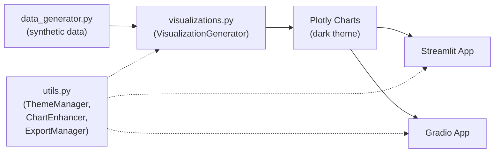

# Architecture

## Data flow

## Core modules

- **data_generator.py:** Creates synthetic datasets for each chart type (e.g., time-series for line charts, coordinates for maps). Uses a fixed random seed.
- **visualizations.py:** Central VisualizationGenerator class that builds all 15 chart types using Plotly. Applies a shared dark theme to every chart. Registry method `get_all_visualizations()` returns all builders for framework-agnostic consumption.
- **streamlit_app.py:** Main UI using Streamlit's sidebar for chart selection, displays the selected Plotly figure with a per-chart description, data summary and quick stats.
- **gradio_app.py:** Parallel interface; same chart registry, Gradio's components for layout and interactivity.
- **utils.py:** Shared utilities—ThemeManager (dark Plotly template, color palette), ChartEnhancer (tooltips, annotations), ExportManager (chart downloads), PerformanceMonitor (render timing).
- **run_apps.py:** Launcher script that starts Streamlit or Gradio without manual CLI invocation.
- **demo.py:** Standalone examples for each chart type.

## No backend

- No database, authentication or persistent state.
- No external API calls; data is generated client-side at runtime.
- Charts are rendered in the browser by Plotly.

## Why dual interfaces

Both Streamlit and Gradio front ends are built on the same visualization engine, so chart code is written once. Only the Streamlit app was run for this portfolio.

Continue with the [technical case study](TECHNICAL_CASE_STUDY.md).
